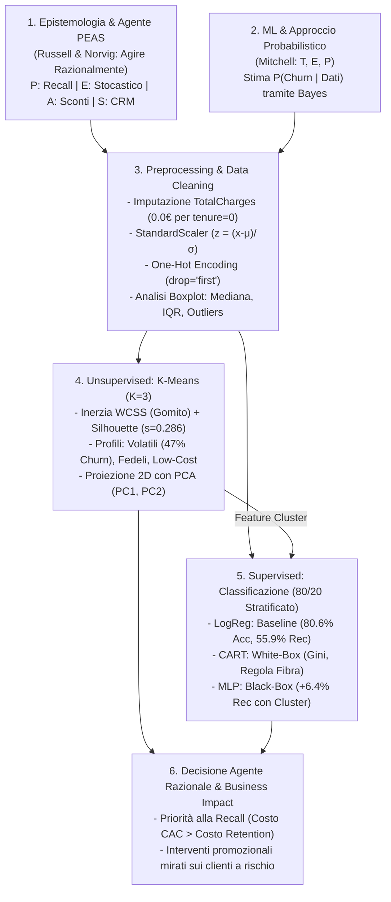

# Guida Completa per l'Esposizione Orale
## Esame di Intelligenza Artificiale --- Progetto Telco Churn Prediction
**Corso del Prof. G. Fiumara / Testo di Riferimento: Russell & Norvig**

> **Note per la stampa in Bianco e Nero:**
> Il documento PDF allegato [`guida_esposizione_orale.pdf`](file:///home/massimo/Scrivania/IA2026/guida_esposizione_orale.pdf) è diviso nelle seguenti sezioni dedicate:
> 1. **Mappa Concettuale** sintetica.
> 2. **Parte 1: Esposizione Orale Slide per Slide** (discorso a voce e transizioni).
> 3. **Parte 2: Guida Dettagliata alla Lettura e al Calcolo dei Grafici** (pagine dedicate).
> 4. **Parte 3: Tavola Completa delle Formule Matematiche dell'Esame** (pagina dedicata).
> 5. **Parte 4: Domande dell'Esaminatore** e **Parte 5: Glossario Tascabile**.

---

# MAPPA CONCETTUALE DELL'ARCHITETTURA DEL PROGETTO

---

# PARTE 1: Esposizione Orale Slide per Slide

## Slide 1: Titolo e Copertina

### Discorso a voce:
> "Buongiorno professore, il mio progetto riguarda la **Churn Prediction e Segmentazione Comportamentale** applicata al settore delle telecomunicazioni, basato sul dataset IBM Telco Customer Churn. L'analisi integra metodologie di apprendimento non supervisionato e supervisionato trattate durante il corso."

---

## Slide 2: Inquadramento Teorico: Epistemologia e Agente PEAS

### Frase di transizione dalla Slide 1 alla 2:
> *"Per inquadrare rigorosamente il progetto da un punto di vista teorico, iniziamo collocando l'IA all'interno dei fondamenti epistemologici di Russell & Norvig e definendo l'Agente Razionale tramite il modello PEAS..."*

### Discorso a voce:
> L'Intelligenza Artificiale si definisce su due assi: Pensare vs. Agire e Umanamente vs. Razionalmente. Il mio lavoro si colloca saldamente nel quadrante dell'**Agire Razionalmente**: l'obiettivo non è simulare i processi cognitivi umani, ma massimizzare l'utilità attesa (la fidelizzazione dei clienti) sulla base dei dati storici CRM.
>
> A destra vediamo la modellizzazione **PEAS** dell'agente:
> - **Performance (P)**: Massimizzare la Recall per intercettare il maggior numero di clienti a rischio ed evitare i Falsi Negativi.
> - **Environment (E)**: L'ambiente CRM Telco, caratterizzato dall'essere stocastico, parzialmente osservabile, sequenziale nel tempo e multi-dimensionale.
> - **Actuators (A)**: Campagne promozionali mirate, sconti personalizzati e supporto clienti.
> - **Sensors (S)**: Registri di fatturazione, tenure e tipologia di contratti.
>
> In basso nel diagramma vediamo il **ciclo di interazione**: attraverso i **Sensori** (a sinistra), l'Agente recepisce i dati dal CRM (spesa e contratto); calcola il rischio di abbandono e, attraverso gli **Attuatori** (a destra), agisce sull'ambiente attivando offerte promozionali e sconti per trattenere il cliente.

---

## Slide 3: Fondamenti di Machine Learning e Approccio Probabilistico

### Frase di transizione dalla Slide 2 alla 3:
> *"Una volta formalizzato l'Agente Razionale in termini di PEAS, si pone la domanda fondamentale: **come fa l'agente a trasformare le percezioni dei Sensori nelle decisioni degli Attuatori?** In un ambiente stocastico e reale non può usare semplici regole rigide del tipo 'SE... ALLORA...'. Deve invece apprendere dai dati del passato attraverso il Machine Learning e la probabilità."*

### Discorso a voce:
> Ho formalizzato questo apprendimento seguendo la celebre definizione di Tom Mitchell del 1997, basata sulla terna T, E, P:
> - **Task (T)**: La classificazione binaria finalizzata a predire l'abbandono (Churn = 1 vs No Churn = 0).
> - **Experience (E)**: L'addestramento sui dati storici dei 7.043 clienti IBM Telco.
> - **Performance (P)**: L'ottimizzazione della Recall al posto della semplice accuratezza.
>
> A destra giustifichiamo la necessità dell'**approccio probabilistico** (di Bayes e Laplace) rispetto alla logica formale rigida (di Boole e Frege). Il comportamento umano è intrinsecamente non deterministico; un sistema a regole rigide fallirebbe per l'esplosione combinatoria delle variabili e la parzialità delle informazioni. La probabilità $P(\text{Churn} \mid \text{Dati})$ ci permette di modellare l'incertezza esprimendo un grado di rischio continuo tra $0\%$ e $100\%$ per ciascun cliente.

---

## Slide 4: Preprocessing dei Dati e Sbilanciamento del Target

### Frase di transizione dalla Slide 3 alla 4:
> *"Dopo aver formalizzato il task di apprendimento $T, E, P$, il primo passo operativo per costruire l'Agente consiste nel preparare i dati storici del CRM e gestire le criticità del dataset..."*

### Discorso a voce:
> Il dataset comprende 7.043 clienti e 21 variabili. Nel preprocessing abbiamo gestito tre aspetti fondamentali:
> - **Data Cleaning**: Gli 11 valori vuoti di spesa totale sono stati imputati a 0.0€ perché relativi a clienti nuovi (`tenure = 0`), salvaguardando dati utili.
> - **Normalizzazione**: I dati numerici sono stati portati sulla stessa scala per evitare che le cifre in Euro schiacciassero i mesi di permanenza nei calcoli dell'IA.
> - **One-Hot Encoding**: La conversione dei testi in colonne di 0 e 1 impedisce all'IA di creare finti ordini di importanza tra le categorie (ad esempio credere che la categoria 3 valga il triplo della 1).
>
> Un elemento cruciale è poi lo **sbilanciamento del target**: solo il **26.54%** dei clienti abbandona. Un classificatore banale (*dummy classifier*) che dicesse sempre 'No Churn' otterrebbe il 73.46% di Accuracy ma una **Recall pari a zero**, risultando del tutto inutile. Identificare chi abbandona ha priorità assoluta, perché perdere un cliente costa molto di più che offrire una promozione.
>
> A destra, i **Boxplot** mostrano la distribuzione di permanenza e spesa:
> - **La linea centrale nella scatola**: è la **Mediana** (il 50° percentile dei clienti).
> - **La scatola (rettangolo)**: racchiude il **50% centrale dei dati** (dall'intervallo $Q_1$ al 25% a $Q_3$ al 75%).
> - **I baffi (linee verticali)**: indicano i valori minimi e massimi ordinari dei dati.
> - **I pallini esterni**: rappresentano i valori anomali (**outliers**).
>
> Dal confronto delle scatole emergono due pattern chiari: chi abbandona (scatola rossa) ha una permanenza mediana di soli **10 mesi** (contro i **38 mesi** di chi resta) e paga bollette medie più alte (**80€/mese** contro **64€/mese**).

---

## Slide 5: Apprendimento Non Supervisionato: Clustering K-Means

### Frase di transizione dalla Slide 4 alla 5:
> *"Una volta pulito e normalizzato il dataset, prima di passare alla classificazione supervisionata ho esplorato la struttura nascosta dei dati tramite l'apprendimento non supervisionato, applicando il clustering K-Means..."*

### Discorso a voce:
> Per l'apprendimento non supervisionato ho utilizzato l'algoritmo **K-Means** per raggruppare spontaneamente i clienti in segmenti omogenei senza usare l'etichetta del Churn.
>
> Per determinare il numero ottimale di cluster $K$, ho analizzato due metriche complementari:
> - **Inerzia (Curva Blu)**: Misura l'errore quadratico interno al cluster (WCSS).
> - **Silhouette Score (Curva Arancione)**: Misura quanto un punto sia simile al suo cluster rispetto agli altri.
>
> Ho selezionato **$K=3$** come scelta ottimale: rappresenta il chiaro 'punto di gomito' dell'inerzia ed ha un valore di Silhouette elevato ($s = 0.286$). Sebbene $K=2$ avesse uno score leggermente più alto, creava una divisione triviale (solo chi ha internet e chi non ce l'ha). Per $K \ge 4$ si osserva invece un crollo della Silhouette, indice di over-clustering e sovrapposizione geometrica.

---

## Slide 6: Segmentazione PCA e Profilo dei Segmenti

### Frase di transizione dalla Slide 5 alla 6:
> *"Dopo aver individuato $K=3$ come numero ottimale di cluster, analizziamo i tre profili di business emersi e verifichiamo la loro separazione geometrica nello spazio tramite la riduzione dimensionale PCA..."*

### Discorso a voce:
> La tabella in alto riassume i 3 profili di business emersi dal K-Means:
> - **Cluster 0 (Volatili)**: Nuovi clienti con tenure breve (13 mesi), spesa mensile alta (75€) e un tasso di churn record del **47.08%** (quasi il doppio della media aziendale!). Rappresenta il target prioritario per l'Agente IA.
> - **Cluster 1 (Fedeli High-Value)**: Utenti storici (59 mesi), spesa alta (90€) e tasso di churn contenuto (15.36%).
> - **Cluster 2 (Low-Cost)**: Clienti con servizi base (27€/mese) ed elevata stabilità (churn al 12.30%).
>
> A destra in basso, la proiezione 2D sulle prime due componenti principali della **PCA** (Principal Component Analysis) conferma visivamente che i tre cluster identificati sono geometricamente ben separati nello spazio.

---

## Slide 7: Pipeline Sperimentale Supervisionata

### Frase di transizione dalla Slide 6 alla 7:
> *"Ora che l'apprendimento non supervisionato ha mappato i segmenti comportamentali dei clienti, passiamo alla fase supervisionata vera e propria, costruendo la pipeline di classificazione..."*

### Discorso a voce:
> Questa slide descrive la pipeline di classificazione supervisionata. A sinistra vediamo il diagramma di flusso: dai dati preprocessati applichiamo uno **split stratificato 80/20** su 7.043 clienti per mantenere l'esatto sbilanciamento del target ($26.54\%$ Churn) sia nel training set che nel test set.
>
> Abbiamo selezionato tre famiglie di modelli rappresentative trattate nel corso:
> 1. **Regressione Logistica**: Baseline parametrica per valutare la separabilità lineare iniziale dei dati.
> 2. **Albero Decisionale CART (White-Box)**: Modello non parametrico trasparente, regolarizzato con `max_depth=5` per evitare l'overfitting ed estrarre regole aziendali esplicite.
> 3. **Rete Neurale MLP (Black-Box)**: Multi-Layer Perceptron feed-forward con attivazione ReLU negli strati nascosti e sigmoide in output, per catturare relazioni non lineari complesse.

---

## Slide 8: Confronto delle Prestazioni Sperimentali

### Frase di transizione dalla Slide 7 alla 8:
> *"Vediamo ora i risultati sperimentali ottenuti sul Test Set, ponendo a confronto le prestazioni dei tre modelli sia nella configurazione base sia con l'integrazione della feature di clustering..."*

### Discorso a voce:
> In questa slide analizziamo i risultati ottenuti sul Test Set ($1.409$ istanze) ponendo a confronto la configurazione Base con la configurazione arricchita dalla feature di Clustering ($K=3$).
>
> I risultati evidenziano due conclusioni fondamentali:
> 1. **Miglior Modello Globale (Regressione Logistica)**: Registra le prestazioni migliori in assoluto (Accuracy **80.6%** e Recall **55.9%**). Questo accade perché i dati contrattuali Telco possiedono un'elevata separabilità lineare e, per il **Rasoio di Occam**, il modello lineare semplice evita l'overfitting a cui le reti complesse sono soggette su dataset tabulari.
> 2. **Impatto del Clustering sulla Rete Neurale (MLP)**: Se la LogReg non beneficia del cluster (avendo già un confine lineare ottimale), l'aggiunta della colonna di cluster fa compiere un balzo straordinario alla **Recall del modello MLP dal 42.8% al 49.2% (+6.4%)**! In questo contesto, l'apprendimento non supervisionato agisce come *Feature Engineering*, fornendo una conoscenza a priori che aiuta l'ottimizzatore Adam ad uscire dai minimi locali.

---

## Slide 9: Spiegabilità Business: Regole dell'Albero Decisionale (CART)

### Frase di transizione dalla Slide 8 alla 9:
> *"Se la Regressione Logistica ha registrato le prestazioni numeriche migliori e la Rete Neurale ha tratto massimo beneficio dal clustering, in ambito aziendale è fondamentale disporre anche di spiegabilità trasparente (White-Box). Analizziamo quindi le regole estratte dall'Albero CART..."*

### Discorso a voce:
> L'Albero Decisionale CART ci fornisce il valore indispensabile della trasparenza (*White-Box*).
>
> Per spiegare la struttura in tre passi:
> - **Passo 1 (Gini)**: L'albero misura l'impurità dei nodi con l'Indice di Gini ($G \in [0, 0.5]$). $G=0$ indica un nodo puro al $100\%$ (tinta scura), mentre $G=0.5$ indica la massima confusione (tinta chiara).
> - **Passo 2 (Colori)**: I nodi arancioni indicano la prevalenza di clienti che RESTANO; i nodi blu indicano la prevalenza di clienti che ABBANDONANO.
> - **Passo 3 (La Regola Estratta)**: Lo split di radice individua come primo fattore la permanenza breve ($\text{tenure} \le 16.5 \text{ mesi}$). Sotto questo ramo, chi possiede un abbonamento in **Fibra Ottica** finisce nei nodi blu scuri a massimo churn (**$>70\%$ di abbandoni**).
>
> L'Agente CRM può utilizzare questa regola esplicita per intervenire tempestivamente con sconti e assistenza sui clienti con Fibra di recente acquisizione.

---

## Slide 10: Discussione Critica, Conclusioni & Sviluppi Futuri

### Frase di transizione dalla Slide 9 alla 10:
> *"Per tirare le somme dell'intero progetto e concludere la presentazione, ricapitoliamo le quattro conclusioni fondamentali e gli sviluppi futuri per il potenziamento dell'Agente IA..."*

### Discorso a voce:
> Per concludere la presentazione, ricapitoliamo 4 punti fondamentali:
> 1. **Valore dell'Integrazione Unsupervised/Supervised**: Il clustering K-Means arricchisce lo spazio delle feature offrendo una mappa pre-calcolata che aumenta la Recall dell'MLP del **+6.4%**.
> 2. **Razionalità Economica e Costo CAC**: L'Agente IA dota di priorità la Recall perché il Customer Acquisition Cost (CAC) per sostituire un cliente perso è nettamente superiore al costo di retention.
> 3. **Trio dei Modelli**: La Regressione Logistica garantisce il miglior rendimento predittivo (Rasoio di Occam), la Rete Neurale beneficia maggiormente del clustering, e l'Albero CART offre la spiegabilità necessaria per le regole aziendali.
> 4. **Sviluppi Futuri (Next Steps)**: Per superare i limiti emersi prevediamo l'uso di **SMOTE** (per generare campioni sintetici di Churn), modelli Ensemble come **Random Forest** (alberi in parallelo a maggioranza) e **XGBoost** (alberi in serie sequenziali), ed infine il **Cost-Sensitive Learning** per pesare la funzione di perdita direttamente in Euro (€) sui costi CAC reali.
>
> Vi ringrazio per l'attenzione e sono a disposizione per le vostre domande!

---

# PARTE 2: Guida Dettagliata alla Lettura e al Calcolo dei Grafici

### 1. Diagramma del Ciclo PEAS (Slide 2)
- **A cosa serve**: Mostra l'architettura dell'Agente Razionale (Russell & Norvig) e il suo ciclo continuo di interazione col CRM.
- **Come si leggono le componenti**:
  - **Sensori (S)**: Input dal CRM (fatturazione, tenure, contratti).
  - **Agente IA**: Inferenza probabilistica $P(\text{Churn} \mid \text{Dati})$.
  - **Attuatori (A)**: Output operativo (offerte, sconti, retention).
  - **Feedback**: Impatto delle azioni sull'ambiente aziendale.

### 2. Boxplot Permanenza & Spesa (Slide 4)
- **A cosa serve**: Confronta le distribuzioni di permanenza e spesa tra chi abbandona (Churn = 1) e chi resta (Churn = 0).
- **Come si leggono le barre e le scatole**:
  - **Asse Y**: Scala della variabile (mesi di permanenza o Euro/mese).
  - **Linea Centrale**: **Mediana** ($Q_2$, 50° percentile).
  - **Scatola**: Intervallo Interquartile ($\text{IQR} = Q_3 - Q_1$, 50% centrale del campione).
  - **Baffi Verticali**: Valori minimi e massimi ordinari ($Q_1 - 1.5 \text{IQR}$, $Q_3 + 1.5 \text{IQR}$).
  - **Pallini Esterni**: Valori anomali (**outliers**).

### 3. Curva Gomito WCSS & Silhouette Score (Slide 5)
- **A cosa serve**: Giustifica la scelta del numero di cluster $K=3$.
- **Come si leggono le curve**:
  - **Asse X**: Numero $K$ di cluster testati (2--8).
  - **Curva Blu (WCSS)**: Errore quadratico interno. Si cerca il punto di gomito in $K=3$.
  - **Curva Arancione (Silhouette)**: Misura di separazione ($s = 0.286$ a $K=3$).

### 4. Scatter Plot 2D PCA & Profilo dei Cluster (Slide 6)
- **A cosa serve**: Dimostra la separazione geometrica dei 3 cluster in uno spazio 2D.
- **Come si leggono gli assi**:
  - **PC1 & PC2**: Componenti principali ortogonali a varianza massima ($X_{\text{pca}} = X W_2$).
  - **Nuvole di Punti**: I tre profili (Volatili Churn 47%, Fedeli High-Value 15%, Low-Cost 12%).

### 5. Diagramma Pipeline Supervisionata (Slide 7)
- **A cosa serve**: Mostra la pipeline di Machine Learning dallo split stratificato 80/20 all'addestramento parallelizzato dei tre classificatori.

### 6. Grafico a Barre delle Prestazioni (Slide 8)
- **A cosa serve**: Confronta Accuracy e Recall tra la configurazione Base e quella con Feature di Clustering.
- **Come si leggono le barre**:
  - **Altezza Barre**: Percentuale delle metriche.
  - **Barra Chiara vs Scura**: Impatto dell'integrazione K-Means (balzo di $+6.4\%$ sulla Recall dell'MLP).

### 7. Grafico dell'Albero Decisionale CART (Slide 9)
- **A cosa serve**: Fornisce spiegabilità trasparente (White-Box) estraendo regole aziendali.
- **Come si leggono le etichette nei nodi**:
  - `gini`: Impurità di Gini ($G \in [0, 0.5]$).
  - `samples`: Numero di clienti nel nodo.
  - `value = [No Churn, Churn]`: Distribuzione delle classi.
  - **Colore**: Arancione = No Churn, Blu = Churn (intensità = purezza del nodo).

---

# PARTE 3: Tavola Completa delle Formule Matematiche dell'Esame

### 1. Normalizzazione Z-Score (StandardScaler)
$$z = \frac{x - \mu}{\sigma}, \qquad \mu = \frac{1}{N} \sum_{i=1}^{N} x_i, \qquad \sigma = \sqrt{\frac{1}{N} \sum_{i=1}^{N} (x_i - \mu)^2}$$

### 2. Clustering K-Means: Funzione Obiettivo WCSS (Inerzia)
$$\text{WCSS} = \sum_{j=1}^{K} \sum_{i \in C_j} \|\mathbf{x}_i - \boldsymbol{\mu}_j\|^2$$

### 3. Silhouette Score per la Qualità del Clustering
$$s(i) = \frac{b(i) - a(i)}{\max\big(a(i), b(i)\big)}, \qquad S = \frac{1}{N} \sum_{i=1}^{N} s(i) \in [-1, +1]$$

### 4. PCA: Riduzione della Dimensionalità
$$\mathbf{\Sigma} = \frac{1}{N} \mathbf{X}^T \mathbf{X}, \qquad \mathbf{\Sigma} \mathbf{v}_k = \lambda_k \mathbf{v}_k, \qquad \mathbf{X}_{\text{pca}} = \mathbf{X} \mathbf{W}_p$$

### 5. Regressione Logistica: Funzione Sigmoide e Log-Loss
$$P(Y=1 \mid \mathbf{x}) = \sigma(\mathbf{w}^T \mathbf{x} + b) = \frac{1}{1 + e^{-(\mathbf{w}^T \mathbf{x} + b)}}$$
$$\mathcal{L}(\mathbf{w}, b) = -\frac{1}{N} \sum_{i=1}^{N} \Big[ y_i \log(\hat{y}_i) + (1 - y_i) \log(1 - \hat{y}_i) \Big]$$

### 6. Rete Neurale MLP: Attivazione ReLU e Output
$$h_j = \text{ReLU}(z_j) = \max(0, z_j), \qquad \hat{y} = \sigma(\mathbf{w}_{\text{out}}^T \mathbf{h} + b_{\text{out}})$$

### 7. Indice di Impurità di Gini per Alberi CART
$$G_i = 1 - \sum_{k=1}^{K} p_{i,k}^2 = 1 - (p_{i,0}^2 + p_{i,1}^2)$$

### 8. Metriche della Matrice di Confusione
$$\text{Recall} = \frac{TP}{TP + FN}, \qquad \text{Accuracy} = \frac{TP + TN}{TP + TN + FP + FN}$$
$$\text{Precision} = \frac{TP}{TP + FP}, \qquad \text{F1-Score} = 2 \cdot \frac{\text{Precision} \cdot \text{Recall}}{\text{Precision} + \text{Recall}}$$

### 9. Statistiche del Boxplot (IQR e Baffi)
$$\text{IQR} = Q_3 - Q_1$$
$$\text{Limite Inf} = \max\Big(\min(X), \, Q_1 - 1.5 \cdot \text{IQR}\Big), \qquad \text{Limite Sup} = \min\Big(\max(X), \, Q_3 + 1.5 \cdot \text{IQR}\Big)$$

---

# PARTE 4: Domande Probabili dell'Esaminatore e Risposte Teoriche

## 1. Domande su Epistemologia e Agente PEAS (Slide 1 -- 2)
1. **P: Perché unire clustering non supervisionato e classificazione supervisionata?**
   - **R:** Perché il clustering K-Means raggruppa i clienti in segmenti omogenei senza conoscere l'esito del Churn, creando una mappa spaziale comportamentale. Utilizzando il cluster come nuova feature nel classificatore supervisionato, forniamo al modello una conoscenza a priori che ne migliora le capacità predittive.
2. **P: Perché l'ambiente CRM è definito stocastico e parzialmente osservabile?**
   - **R:** È **stocastico** perché la decisione finale del cliente di abbandonare non è deterministica ma incerta; è **parzialmente osservabile** perché il database del CRM registra solo i dati contrattuali, ma non registra fattori esterni invisibili.

---

## 2. Domande su Machine Learning e Probabilità (Slide 3)
1. **P: Perché preferiamo la probabilità $P(\text{Churn} \mid \text{Dati})$ rispetto a una regola secca SE... ALLORA...?**
   - **R:** Perché una probabilità continua permette all'azienda di effettuare un **ranking** dei clienti a rischio, allocando le risorse promozionali prioritariamente sui clienti a più alto rischio.

---

## 3. Domande su Preprocessing, Data Cleaning e Boxplot (Slide 4)
1. **P: Perché avete imputato 0.0€ ai 11 valori vuoti di TotalCharges invece di eliminare le righe o usare la media?**
   - **R:** Perché quei 11 clienti avevano `tenure = 0` mesi (appena acquisiti), quindi la spesa totale accumulata era logicamente pari a 0.0€. Rimuovere le righe avrebbe causato una perdita di dati non necessaria.
2. **P: A cosa servono lo StandardScaler e il drop='first' nel One-Hot Encoding?**
   - **R:** Lo **StandardScaler** porta le feature continue alla stessa scala ($z = \frac{x-\mu}{\sigma}$). Il **`drop='first'`** elimina la colonna ridondante per evitare la multicollinearità perfetta.
3. **P: Come è fatta la struttura del Boxplot e cosa rappresenta la linea centrale?**
   - **R:** La linea centrale è la **Mediana** (50° percentile). La scatola racchiude il 50% centrale dei dati (IQR = $Q_3 - Q_1$). I baffi indicano il range non anomalo e i punti esterni gli outlier.

---

## 4. Domande su Clustering K-Means e PCA (Slide 5 -- 6)
1. **P: Cos'è la funzione obiettivo minimizzata da K-Means?**
   - **R:** K-Means minimizza la WCSS: $\sum_{j=1}^{K} \sum_{i \in C_j} \|\mathbf{x}_i - \boldsymbol{\mu}_j\|^2$.
2. **P: Perché abbiamo usato la PCA qui e cos'è X_pca?**
   - **R:** La PCA riduce la dimensionalità a 2 coordinate sintetiche (`PC1` e `PC2` in `X_pca`) per dimostrare visivamente che i 3 cluster emersi sono ben separati.

---

## 5. Domande su Pipeline Supervisionata e Prestazioni (Slide 7 -- 8)
1. **P: Cosa significa split stratificato e perché è obbligatorio?**
   - **R:** Garantisce che la percentuale del target (26.54% Churn) sia identica sia nel Train che nel Test Set.
2. **P: Come mai la Regressione Logistica batte la Rete Neurale su questo dataset?**
   - **R:** I dati tabulari hanno forte separabilità lineare. Per il **Rasoio di Occam**, il modello lineare non va in overfitting. L'MLP guadagna comunque $+6.4\%$ di Recall col cluster.

---

## 6. Domande su Spiegabilità CART (Slide 9 -- 10)
1. **P: Cos'è la formula dell'Indice di Gini e perché si usa?**
   - **R:** $G_i = 1 - \sum p_{i,k}^2$. Misura il disordine del nodo per massimizzare il guadagno di purezza.

---

# PARTE 5: Glossario Tascabile dei Termini per l'Orale

| Termine | Definizione Breve da Usare all'Orale |
| :--- | :--- |
| **PEAS** | Modello formalizzante dell'agente razionale: *Performance, Environment, Actuators, Sensors*. |
| **CRM** | *Customer Relationship Management*: sistema che gestisce dati e contratti clienti. |
| **CAC** | *Customer Acquisition Cost*: costo sostenuto per trovare un nuovo cliente. |
| **Recall** | Quanti clienti in abbandono reale l'IA è riuscita a scovare (minimizza Falsi Negativi). |
| **AUC-ROC** | Area Sotto la Curva ROC: misura la capacità di separazione delle classi. |
| **K-Means** | Algoritmo di clustering non supervisionato basato sulla minimizzazione di WCSS. |
| **Silhouette Score** | Indice tra $-1$ e $+1$ che misura compattezza del cluster e separazione dagli altri. |
| **PCA** | *Principal Component Analysis*: riduzione della dimensionalità a varianza massima. |
| **StandardScaler** | Trasformazione $z = (x - \mu)/\sigma$ che porta le feature a media 0 e varianza 1. |
| **One-Hot Encoding** | Conversione di variabili categoriali in colonne binarie ($0/1$) con `drop='first'`. |
| **Indice di Gini** | Misura di impurità di un nodo negli alberi CART ($0=$ puro, $0.5=$ 50/50). |
| **CART** | *Classification and Regression Trees*: albero decisionale binario. |
| **MLP** | *Multi-Layer Perceptron*: rete neurale artificiale feed-forward con Backpropagation. |
| **SMOTE** | *Synthetic Minority Over-sampling Technique*: generatore sintetico classe minoritaria. |
