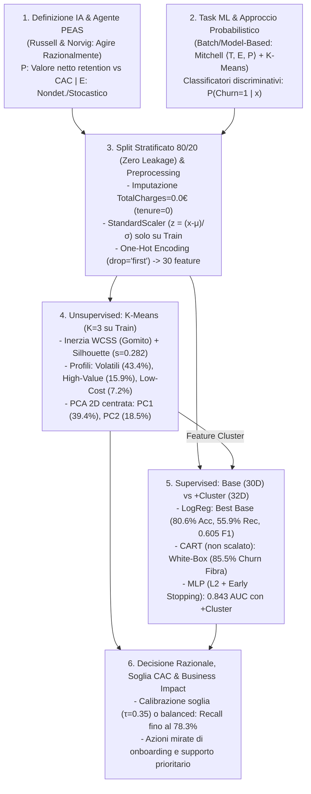

# Guida Completa per l'Esposizione Orale
## Esame di Intelligenza Artificiale — Progetto Telco Churn Prediction
**Corso del Prof. G. Fiumara / Testi di Riferimento: Russell & Norvig, Géron, Mitchell**

> **Versione stampabile:** [`guida_esposizione_orale.pdf`](guida_esposizione_orale.pdf) (ottimizzata in bianco e nero), divisa in Mappa Concettuale, Esposizione Slide per Slide, Guida ai Grafici, Tavola delle Formule, Domande Probabili e Glossario.

---

# MAPPA CONCETTUALE DELL'ARCHITETTURA DEL PROGETTO

---

# PARTE 1: Esposizione Orale Slide per Slide

## Slide 1: Titolo e Copertina
> "Buongiorno professore, il mio progetto riguarda la **Churn Prediction e Segmentazione Comportamentale** applicata al settore Telco, basata sul dataset IBM Telco Customer Churn. L'analisi integra metodologie di apprendimento non supervisionato e supervisionato trattate durante il corso."

## Slide 2: Inquadramento Teorico: Definizione di IA e Agente PEAS
* **Transizione:** *"Inquadriamo il problema secondo i quattro approcci alla definizione di IA di Russell e Norvig e definiamo l'Agente Razionale tramite il modello PEAS..."*
> L'IA si articola su due assi: Pensiero vs Comportamento e Umanamente vs Razionalmente, individuando i quattro approcci (*modellazione cognitiva*, *leggi del pensiero*, *Test di Turing* e *agente razionale*). Adottiamo l'**Agire Razionalmente** (agente con apprendimento basato su utilità): selezionare azioni che massimizzano il valore atteso della misura di prestazione ($P$) in condizioni di incertezza, senza onniscienza, bilanciando tramite utilità churn evitato e costo offerte.
> - **Performance (P)**: Valore netto di fidelizzazione (ridurre gli abbandoni contenendo i costi rispetto al CAC).
> - **Environment (E)**: Ecosistema operativo dei clienti Telco: *parzialmente osservabile*, *nondeterministico* (modellato *stocasticamente*), *multi-agente*, *continuo* su tempo/importi e *sconosciuto* prima del training ML; *sequenziale*/*dinamico* nel ciclo reale, *episodico*/*statico* nella singola predizione batch.
> - **Actuators (A)**: Offerte promozionali mirate, sconti e supporto tecnico prioritario.
> - **Sensors (S)**: Log CRM di fatturazione, *tenure*, contratti e servizi attivi.

## Slide 3: Formulazione dei Task ML e Approccio Probabilistico
* **Transizione:** *"Come fa l'agente a mappare le percezioni dei Sensori nelle decisioni degli Attuatori? Apprendendo dai dati storici tramite due task integrati..."*
> Adottiamo un sistema **Batch** e **Model-Based** (Lezione 03) su due task:
> - **Task Supervisionato (Mitchell $\langle T, E, P \rangle$)**: Compito $T$ di classificazione binaria probabilistica di `Churn`, Esperienza $E$ su `5.634` istanze etichettate (da `7.043` clienti), Prestazione $P$ valutata con `Recall`, `Precision`, `F1-Score`, `AUC-ROC`.
> - **Task Non Supervisionato**: Clustering **K-Means** su `30` feature senza usare `Churn` (Inerzia WCSS + Silhouette) + **PCA** 2D, verificandone l'impatto come feature.
> Rispetto a regole booleane manuali (fragili e non scalabili), i nostri classificatori **probabilistici discriminativi** stimano direttamente $P(\text{Churn}=1 \mid \mathbf{x}) \in [0,1]$ per ordinare i clienti per rischio e tarare la soglia decisionale rispetto al CAC.

## Slide 4: Dataset Telco: Preprocessing e Sbilanciamento del Target
* **Transizione:** *"Passiamo alla preparazione rigorosa dei dati e all'analisi esplorativa..."*
> Garantiamo **zero data leakage**:
> - **Data Cleaning**: Gli 11 spazi vuoti in `TotalCharges` appartengono a clienti nuovi con `tenure = 0` e vengono imputati a `0.0€`; rimuoviamo `customerID`.
> - **Split Stratificato 80/20**: Eseguito **prima** di scaling e clustering (`5.634` train, `1.409` test).
> - **Standardizzazione Z-Score** (`StandardScaler` fit solo su train) e **One-Hot Encoding** (`drop='first'`) $\rightarrow$ **30 feature**.
> - **Sbilanciamento**: Solo il **26.54%** abbandona (modello *dummy*: 73.46% Accuracy ma **Recall = 0%**). I boxplot mostrano permanenza mediana **10.0 mesi** (vs **38.0**) e spesa mensile **79.65€** (vs **64.43€**).

## Slide 5: Apprendimento Non Supervisionato: Clustering K-Means
* **Transizione:** *"Sul solo Training Set standardizzato esploriamo la struttura latente tramite K-Means..."*
> Addestriamo il **K-Means** (scelto per scalabilità, centroidi interpretabili e presenza del metodo induttivo `.predict()` sul Test Set senza leakage, a differenza di DBSCAN) sulle 30 feature del Training Set (`5.634` clienti) senza usare `Churn`. Confrontando $K \in \{2, 3, 4, 5, 6\}$ con **Inerzia WCSS** (Metodo del Gomito) e **Silhouette Score** (che combina coesione $a_i$ e separazione $b_i$), scegliamo **$K=3$**: $K=2$ (`0.293`) separa solo presenza/assenza internet; $K=3$ coincide col gomito (`33.485 -> 24.642`) mantenendo $s=0.282$ (separazione moderata ma fisiologica in 30D misto), mentre per $K \ge 4$ la Silhouette crolla (`0.230 -> 0.185`).

## Slide 6: Segmentazione PCA e Profilo dei Segmenti
* **Transizione:** *"Analizziamo i tre segmenti aziendali emersi e la loro proiezione 2D con la PCA..."*
> - **Cluster 0 (Volatili)**: 2.557 clienti train, `15.2` mesi, `67.87€`, **43.4% churn** (43.3% sul Test Set).
> - **Cluster 1 (Fedeli High-Value)**: 1.863 clienti train, `57.7` mesi, `89.44€`, **15.9% churn**.
> - **Cluster 2 (Low-Cost)**: 1.214 clienti train, `30.2` mesi, `21.12€`, **7.2% churn**.
> La **PCA** sui dati centrati spiega il **57.9%** della varianza (`PC1 39.4%`: Spesa e Volume Servizi; `PC2 18.5%`: Anzianità e Stabilità Contrattuale).

## Slide 7: Pipeline Sperimentale Supervisionata
* **Transizione:** *"Vediamo ora come i segmenti interagiscono con la classificazione supervisionata..."*
> Confrontiamo tre classificatori probabilistici discriminativi su Base (30D) vs +Cluster (32D senza leakage):
> 1. **Regressione Logistica**: Baseline lineare convessa.
> 2. **Albero CART (`max_depth=5`)**: Addestrato su feature numeriche **non scalate** (invarianza alle trasformazioni monotone, Lezione 05) per regole leggibili in mesi ed Euro.
> 3. **MLP `(64, 32)`**: Attivazione ReLU, output sigmoideo, Adam, regolarizzazione L2 (`alpha=0.1`) ed *early stopping* (Lezioni 07–08).

## Slide 8: Confronto delle Prestazioni Sperimentali
* **Transizione:** *"Esaminiamo i risultati reali sul Test Set e l'impatto della soglia decisionale..."*
> Con L2 ed *early stopping*, l'MLP non va in overfitting e raggiunge `AUC = 0.8424`, salendo con +Cluster a **0.8429** (migliore AUC assoluta; Recall `51.9% -> 52.1%`, F1 `0.579 -> 0.585`). Tuttavia la **Regressione Logistica** resta migliore su Accuracy (**80.6%**), Recall (**55.9%**) e F1 (**0.605**), confermando il **Rasoio di Occam**. Calibrando la soglia a $\tau=0.35$ (su CV del training) o usando `class_weight='balanced'`, la Recall della Logistica sale fino al **70.3%--78.3%** (`F1 = 0.614`).

## Slide 9: Spiegabilità Business: Regole dell'Albero Decisionale (CART)
* **Transizione:** *"Analizziamo le regole trasparenti estratte dall'albero CART..."*
> L'albero usa l'**Indice di Gini** ($G_i \in [0, 0.5]$ per $K=2$ classi). Sui 5.634 campioni di training non scalati, la radice è `tenure <= 16.5` mesi; seguendo il ramo in **Fibra Ottica** (68.3% churn) e `TotalCharges <= 120.0€` (primi mesi), il nodo blu scuro di livello 3 raggiunge l'**85.5% di Churn** (`165 / 193`, $G=0.248$), e il successivo split su assenza di `TechSupport` (livello 4) sale all'**87.6%** (`162 / 185`).

## Slide 10: Discussione Critica, Conclusioni & Sviluppi Futuri
> 1. **Ruolo Reale del Clustering**: Valore soprattutto descrittivo/strategico (Volatili 43.4% churn) + lieve boost AUC su MLP (`0.843`).
> 2. **Razionalità Economica & Soglia CAC**: Calibrazione soglia / `balanced` eleva Recall fino al **78.3%**.
> 3. **Equilibrio Modelli**: LogReg vince per il Rasoio di Occam; CART garantisce spiegabilità White-Box.
> 4. **Limiti & Sviluppi**: Cluster sferici K-Means, dataset statico, rispetto GDPR/\textit{fairness}; estensioni con **Random Forest / XGBoost**, **Soft Clustering (`transform()`)**, **SMOTE** e **Cost-Sensitive Learning**.

---

# PARTE 2: Guida Dettagliata alla Lettura dei Grafici

1. **Ciclo PEAS (Slide 2):** Sensori (log CRM) $\rightarrow$ Agente Razionale (stima $P(\text{Churn}=1 \mid \mathbf{x})$) $\rightarrow$ Attuatori (retention vs CAC).
2. **Boxplot (Slide 4):** Mediana ($Q_2$), scatola ($\text{IQR}=Q_3-Q_1$), baffi ($1.5 \cdot \text{IQR}$), outlier. Mediane: `tenure` `10.0 vs 38.0` mesi; `MonthlyCharges` `79.65€ vs 64.43€`.
3. **Elbow & Silhouette (Slide 5):** $K \in \{2..6\}$ sul Training Set. Gomito blu a $K=3$ (`33.485 -> 24.642`), Silhouette arancione $s=0.2817$ a $K=3$, poi crollo per $K \ge 4$.
4. **PCA 2D (Slide 6):** Proiezione centrata delle 30 feature su `PC1` (39.4%) e `PC2` (18.5%), totale 57.9%.
5. **Pipeline Supervisionata (Slide 7):** Split 80/20 prima di scaling e clustering (zero leakage).
6. **Barre Prestazioni (Slide 8):** Recall ($\tau=0.50$) e AUC-ROC generate dinamicamente da `results_df`.
7. **Albero CART (Slide 9):** `samples = 5634` in radice (`value = [4139, 1495]`, `gini = 0.39`). Arancione = Rimasto, Blu = Abbandono.

---

# PARTE 3: Formule Matematiche Essenziali

- **Standardizzazione Z-Score:** $z = \frac{x - \mu_{\text{train}}}{\sigma_{\text{train}}}$
- **Inerzia K-Means (WCSS):** $\text{WCSS} = \sum_{j=1}^K \sum_{\mathbf{x}_i \in C_j} \|\mathbf{x}_i - \boldsymbol{\mu}_j\|^2$
- **Silhouette Score:** $s(i) = \frac{b(i)-a(i)}{\max(a(i), b(i))} \in [-1, +1]$
- **PCA (dati centrati $\mathbf{X}_c = \mathbf{X}-\bar{\mathbf{X}}$):** $\boldsymbol{\Sigma} = \frac{1}{N-1}\mathbf{X}_c^T\mathbf{X}_c$, $\boldsymbol{\Sigma}\mathbf{v}_k = \lambda_k\mathbf{v}_k$, $\mathbf{X}_{\text{pca}} = \mathbf{X}_c[\mathbf{v}_1,\mathbf{v}_2]$
- **Regressione Logistica:** $P(Y=1 \mid \mathbf{x}) = \sigma(\mathbf{w}^T\mathbf{x}+b) = \frac{1}{1+e^{-(\mathbf{w}^T\mathbf{x}+b)}}$ con Binary Cross-Entropy
- **MLP (ReLU + L2):** $h_j = \max(0, z_j)$, $\mathcal{J}(\boldsymbol{\theta}) = \mathcal{L}(\boldsymbol{\theta}) + \frac{\alpha}{2}\|\mathbf{W}\|_2^2$
- **Gini ($K=2$):** $G_i = 1 - (p_{i,0}^2 + p_{i,1}^2) \in [0, 0.5]$
- **Metriche:** $\text{Recall}=\frac{TP}{TP+FN}$, $\text{Precision}=\frac{TP}{TP+FP}$, $F_1 = 2\frac{\text{Prec}\cdot\text{Rec}}{\text{Prec}+\text{Rec}}$

---

# PARTE 4: Domande Tipiche dell'Esaminatore

1. **Differenza tra $P$ nel PEAS e $P$ in Mitchell?**  
   Nel PEAS $P$ valuta l'esito economico nell'ambiente (fidelizzazione netta rispetto al CAC); in Mitchell $\langle T, E, P \rangle$ valuta la qualità predittiva sul task (Recall, Precision, F1, AUC-ROC).
2. **Come avete evitato il *data leakage*?**  
   Eseguendo `train_test_split` stratificato 80/20 prima di `StandardScaler`, `OneHotEncoder`, K-Means e PCA (tutti fittati solo sui 5.634 campioni di training).
3. **I vostri modelli usano il teorema di Bayes?**  
   No: Regressione Logistica, CART e MLP sono classificatori probabilistici *discriminativi* che stimano direttamente $P(Y=1 \mid \mathbf{x})$ senza modellare $P(\mathbf{x} \mid Y)$.
4. **Perché il Decision Tree non usa feature scalate?**  
   Perché gli alberi CART sono invarianti alle trasformazioni monotone (Lezione 05): le metriche non cambiano, ma le soglie restano direttamente leggibili in mesi ed Euro.
5. **Perché calibrare la soglia decisionale?**  
   Con target sbilanciato (26.5%), $\tau=0.50$ limita la Recall al 55.9%. Con $\tau=0.35$ o `class_weight='balanced'`, la Recall sale al 70.3%--78.3%, migliorando anche l'F1-Score (`0.614`).
6. **Perché avete scelto K-Means invece di DBSCAN?**  
   Per scalabilità lineare, centroidi interpretabili nel CRM e disponibilità di `.predict()` *out-of-sample* sul Test Set senza causare *data leakage* (non supportato nativamente da DBSCAN).
